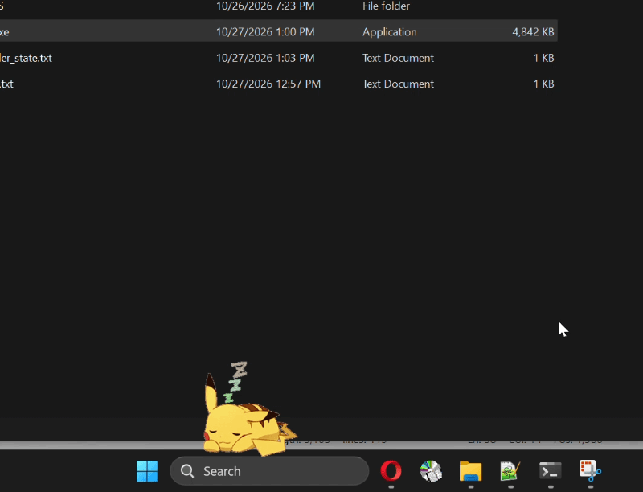
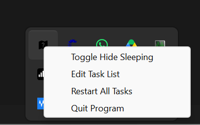

## C++ Routine Reminder



### The Purpose
- Routine Reminder is your silly computer bot that will nag you until you get some work done.
- You can write in the source.txt file what tasks must be completed, in what time frame, and how often reminders should be given. 
- Time frames can be DAILY or WEEKLY. If marked as DAILY, the program will nag you for that same task the next day.
- If marked as WEEKLY, the program will only nag you until you get the task done for the week.

### TrayIcon Interface



### Example:
```
> Sets a delay between reminders - 30 minutes
DELAY 30 
> Sets the size of one frame of the actor spritesheet.(You can provide your own actor graphics.)
ACTORSIZE 250 250
> Reminds you of this task until you get it done for that day. It will ask again the next day.
DAILY "exercise"
DAILY "do the dishes"
> Reminds you of this task until you get it done for that week. It will ask again the next week.
WEEKLY "burn the garbage"
```